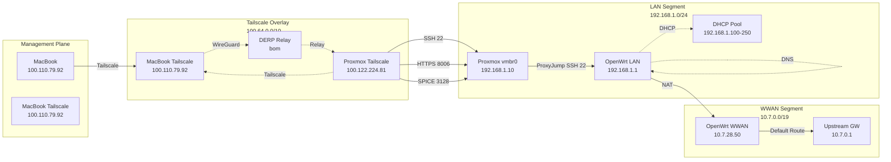

# Network Topology

## Physical Topology

```mermaid
graph TB
    subgraph "External"
        Internet[Internet\nCollege Network]
        WiFi[College Wi-Fi\nSSID: Rishihood_Learner\nCH149, 5GHz, WPA2]
        GW[Upstream Gateway\n10.7.0.1]
        DERP[DERP Relay\nbom \(Mumbai\)]
        TSControl[Tailscale Control Plane]
    end

    subgraph "OpenWrt Router\nTP-Link Archer C20 v5"
        OWRT[OpenWrt 25.12.6\nMT7628AN + MT76x2]
        
        subgraph "Interfaces"
            WWAN[phy1-sta0\n10.7.28.50/19\nWWAN Client]
            LAN[br-lan\n192.168.1.1/24\nLAN Bridge]
            VLAN1[eth0.1 VLAN1\nPorts 1-4, CPU tagged]
            VLAN2[eth0.2 VLAN2\nPort 0, CPU tagged]
            Radio0[phy0-ap0\nCH1, HT20\n2.4GHz AP]
            Radio1_STA[phy1-sta0\nCH149, VHT40\n5GHz STA ↑]
            Radio1_AP[phy1-ap0\nDISABLED\n5GHz AP]
        end
    end

    subgraph "Proxmox VE Host\nDell Inspiron N4010"
        PVE[Proxmox VE 9.2.2]
        
        subgraph "Interfaces"
            VMBr0[vmbr0\n192.168.1.10/24\nBridge: enx00e04c685ea8]
            TS0[tailscale0\n100.122.224.81/32]
            PHY[enx00e04c685ea8\nPhysical NIC]
        end
        
        subgraph "Storage"
            LVM[local-lvm\n151GB LVM-thin]
            DIR[local\n72GB dir]
            HDD[hdd-storage\n479GB dir]
        end
    end

    subgraph "Control Machine"
        MB[MacBook Pro\nmacOS]
        TS_MB[Tailscale\n100.110.79.92]
        Ansible[Ansible Controller]
    end

    %% Connections
    Internet -->|Wi-Fi| WiFi
    WiFi -.->|WWAN DHCP| WWAN
    WWAN -->|Default Route| GW
    GW --> Internet
    
    WWAN -.->|NAT| LAN
    LAN -.->|DHCP/DNS| VLAN1
    VLAN1 -.->|Port 1| PHY
    PHY -.->|vmbr0| VMBr0
    
    Radio0 -.->|2.4GHz WiFi| LAN
    Radio1_STA -.->|5GHz STA| WWAN
    Radio1_AP -.->|5GHz AP \(DOWN\)| LAN
    
    TS0 -.->|Tailscale Mesh| TS_MB
    TS0 -.->|DERP| DERP
    TS_MB -.->|Tailscale Mesh| DERP
    DERP -.->|Relay| TSControl
    
    Ansible -.->|SSH/Ansible| TS_MB
    TS_MB -.->|Tailscale| TS0
    TS0 -.->|ProxyJump SSH| LAN
    Ansible -.->|Ansible over SSH| TS0
    Ansible -.->|Ansible via ProxyJump| LAN
```

## Logical Topology



## Interface Mapping

### OpenWrt (Archer C20 v5)

| Logical Name | Physical Interface | IP Address | Role |
|--------------|-------------------|------------|------|
| `br-lan` | Bridge (eth0.1) | 192.168.1.1/24 | LAN gateway, management |
| `phy1-sta0` | WiFi radio1 (5GHz) | 10.7.28.50/19 | WWAN upstream client |
| `phy0-ap0` | WiFi radio0 (2.4GHz) | Bridged to br-lan | 2.4GHz AP |
| `phy1-ap0` | WiFi radio1 (5GHz) | **Disabled** | 5GHz AP (conflict) |
| `eth0.1` | Switch VLAN 1 | Bridge port | LAN ports 1-4 |
| `eth0.2` | Switch VLAN 2 | Bridge port | WAN port (unused) |
| `lo` | Loopback | 127.0.0.1/8 | Local |

### Proxmox (Dell Inspiron N4010)

| Logical Name | Physical Interface | IP Address | Role |
|--------------|-------------------|------------|------|
| `vmbr0` | Bridge (enx00e04c685ea8) | 192.168.1.10/24 | Management, VM bridge |
| `tailscale0` | Tailscale virtual | 100.122.224.81/32 | Overlay management |
| `enx00e04c685ea8` | USB-Ethernet dongle | 192.168.1.10 (via bridge) | Physical uplink |
| `lo` | Loopback | 127.0.0.1/8 | Local |

### MacBook (Control)

| Interface | IP Address | Role |
|-----------|------------|------|
| `en0` (WiFi) | 100.110.79.92/32 | Tailscale |
| `en3`/`en4` (Ethernet) | 192.168.29.x (varies) | Local network (not homelab) |

## VLAN Configuration (OpenWrt mt7530 Switch)

```
┌─────────────────────────────────────────────────────────────┐
│                    mt7530 Switch Chip                        │
│                                                              │
│  Port 0 (WAN) ──────────► VLAN 2 (tagged CPU: eth0.2)       │
│  Port 1 (LAN) ──────────► VLAN 1 (untagged, tagged CPU)     │
│  Port 2 (LAN) ──────────► VLAN 1                             │
│  Port 3 (LAN) ──────────► VLAN 1                             │
│  Port 4 (LAN) ──────────► VLAN 1                             │
│  Port 6 (CPU) ──────────► VLAN 1 (tagged), VLAN 2 (tagged)  │
│                                                              │
│  VLAN 1 → eth0.1 → br-lan (192.168.1.1/24)                   │
│  VLAN 2 → eth0.2 → wan interface (DHCP, currently DOWN)     │
└─────────────────────────────────────────────────────────────┘
```

## Routing Tables

### OpenWrt
```
Destination        Gateway         Interface    Flags
default            10.7.0.1        phy1-sta0    UG
10.7.0.0/19        0.0.0.0         phy1-sta0    U
192.168.1.0/24     0.0.0.0         br-lan       U
fd93:f7f5:2744::/64 0.0.0.0        br-lan       U
unreachable fd93:f7f5:2744::/48   lo            !
```

### Proxmox
```
Destination        Gateway         Interface    Flags
default            192.168.1.1     vmbr0        UG
192.168.1.0/24     0.0.0.0         vmbr0        U
192.168.1.0/24     0.0.0.0         enx00e04c685ea8  U
```

### MacBook (Tailscale only for homelab)
```
Tailscale routes managed by tailscaled:
100.64.0.0/10 → tailscale0 (100.110.79.92)
```

## Firewall Traffic Flow

### OpenWrt (nftables/fw4)
```
LAN (192.168.1.0/24)
    │
    ├─► INPUT: ACCEPT (all)
    ├─► OUTPUT: ACCEPT (all)
    ├─► FORWARD: ACCEPT → WAN
    │
    ▼
WAN Zone (wan, wan6, wwan)
    │
    ├─► INPUT: REJECT (except DHCPv6, ICMPv6, IGMP, MLD)
    ├─► OUTPUT: ACCEPT
    ├─► FORWARD: DROP (except ESP, ISAKMP, ICMPv6)
    └─► MASQUERADE: Enabled
```

### Proxmox (pve-firewall / iptables)
```
INPUT Chain (policy DROP via PVEFW)
    │
    ├─► ts-input (Tailscale chain) - FIRST
    │       ├─► ACCEPT all from tailscale0 interface
    │       ├─► ACCEPT UDP 41641 from anywhere (DERP)
    │       └─► DROP Tailscale subnet on non-tailscale0
    │
    ├─► PVEFW-INPUT (Proxmox firewall)
    │       ├─► ACCEPT established/related
    │       ├─► ACCEPT lo
    │       ├─► ACCEPT SSH (22) from 192.168.1.0/24
    │       ├─► ACCEPT SSH (22) from 100.122.224.81/32
    │       ├─► ACCEPT Web UI (8006) from 192.168.1.0/24
    │       ├─► ACCEPT Web UI (8006) from 100.122.224.81/32
    │       ├─► ACCEPT SPICE (3128) from 192.168.1.0/24
    │       ├─► ACCEPT SPICE (3128) from 100.122.224.81/32
    │       └─► DROP all else
    │
    └─► DROP
```

## Network Trust Boundaries Visualized

```
┌─────────────────────────────────────────────────────────────────────────────┐
│                        UNTRUSTED: College Wi-Fi (10.7.0.0/19)               │
│  • No management access                                                     │
│  • No SSH, no LuCI, no DNS                                                  │
│  • Only: DHCP renew, ICMP, IGMP, DHCPv6, MLD, ICMPv6                       │
└─────────────────────────────────────────────────────────────────────────────┘
                                    │
                                    │ NAT + Firewall
                                    ▼
┌─────────────────────────────────────────────────────────────────────────────┐
│                        TRUSTED: LAN (192.168.1.0/24)                        │
│  • Full management: SSH, HTTPS (LuCI, Proxmox), SPICE                       │
│  • DHCP, DNS, NTP                                                           │
│  • Proxmox vmbr0, OpenWrt br-lan                                            │
└─────────────────────────────────────────────────────────────────────────────┘
                                    │
                                    │ Tailscale Overlay
                                    ▼
┌─────────────────────────────────────────────────────────────────────────────┐
│                        TRUSTED: Tailscale (100.64.0.0/10)                   │
│  • Proxmox: 100.122.224.81                                                  │
│  • MacBook: 100.110.79.92                                                   │
│  • SSH, Web UI, SPICE allowed via Proxmox firewall                          │
│  • ts-input chain handles all Tailscale traffic                             │
└─────────────────────────────────────────────────────────────────────────────┘
```

---

*See [Architecture Overview](overview.md) for system context, [Hardware Inventory](hardware-inventory.md) for device specs, [IP Addressing](ip-addressing.md) for complete allocation, and [Security Architecture](security-architecture.md) for threat model.*